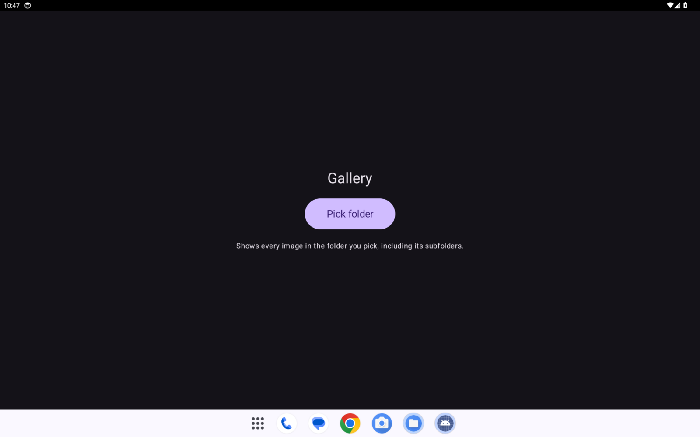
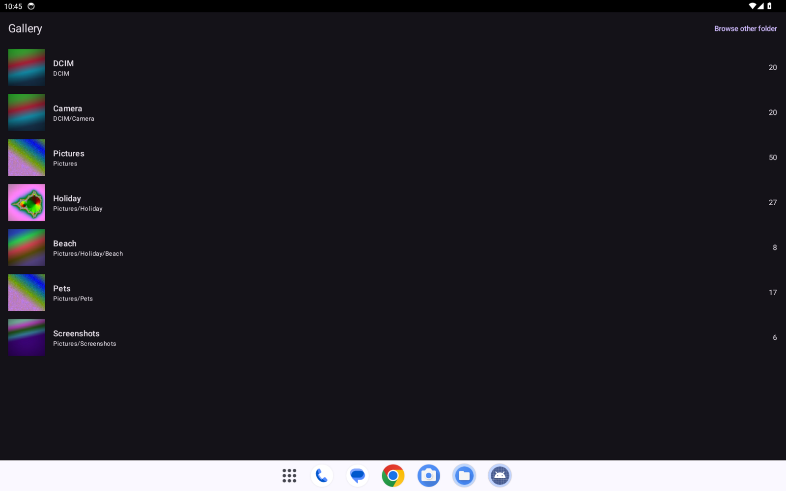
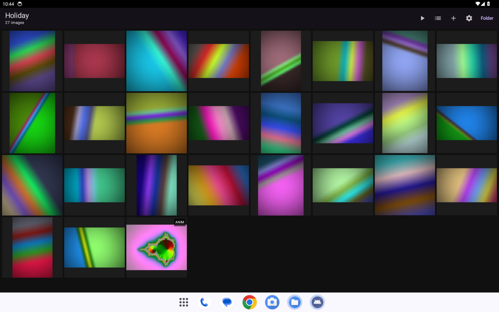
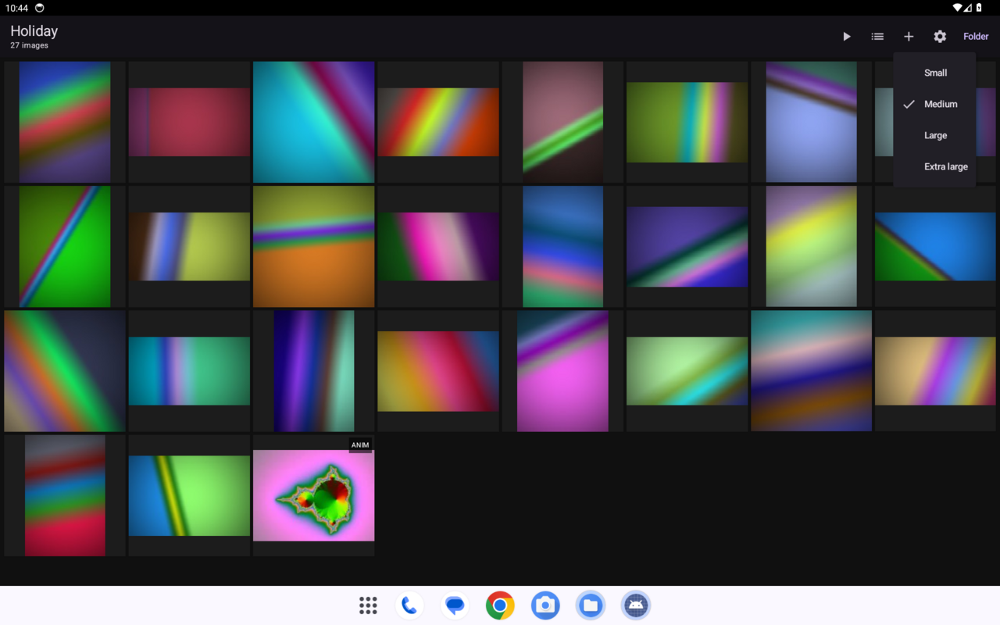
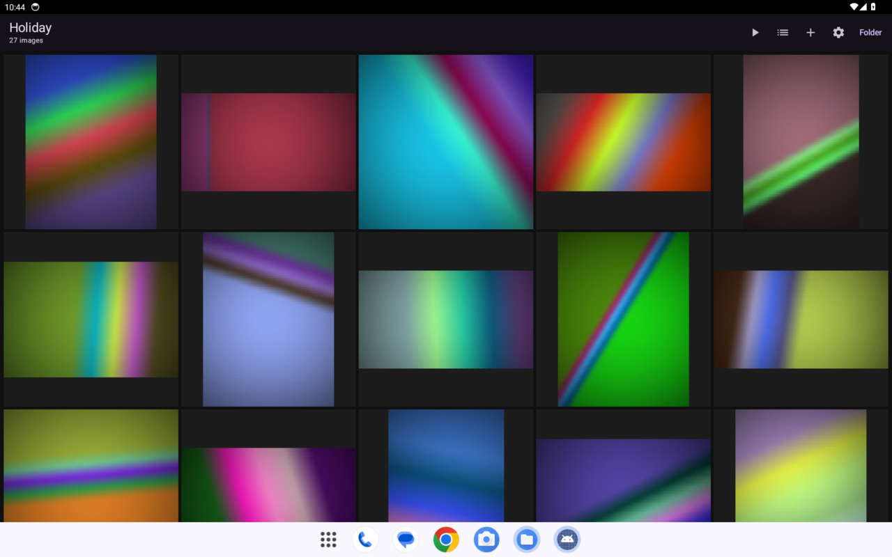
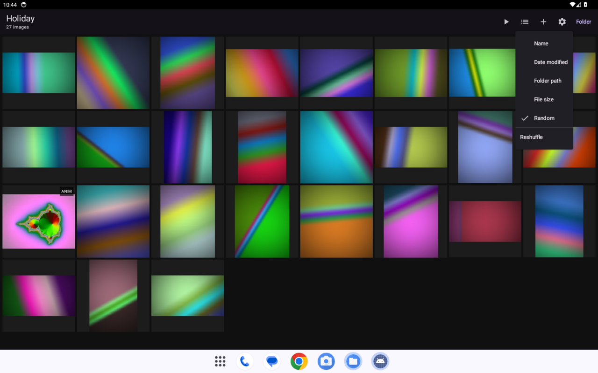
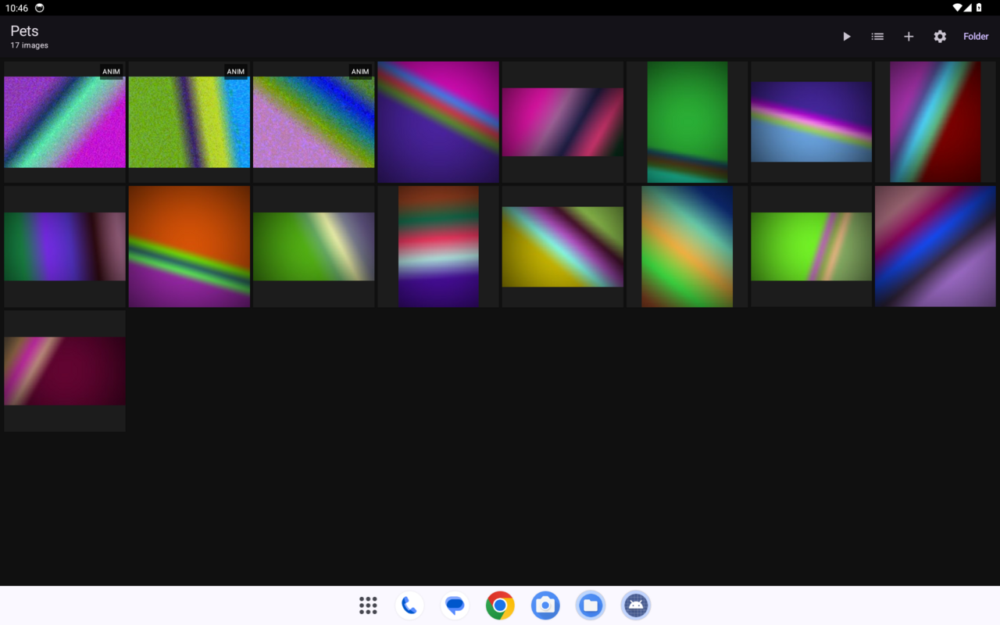
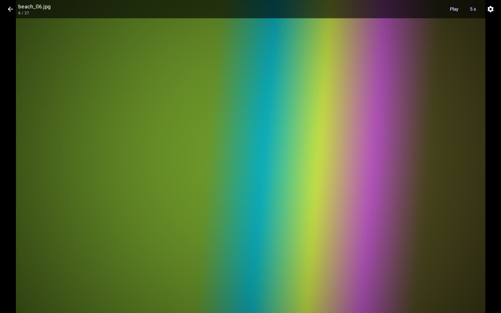
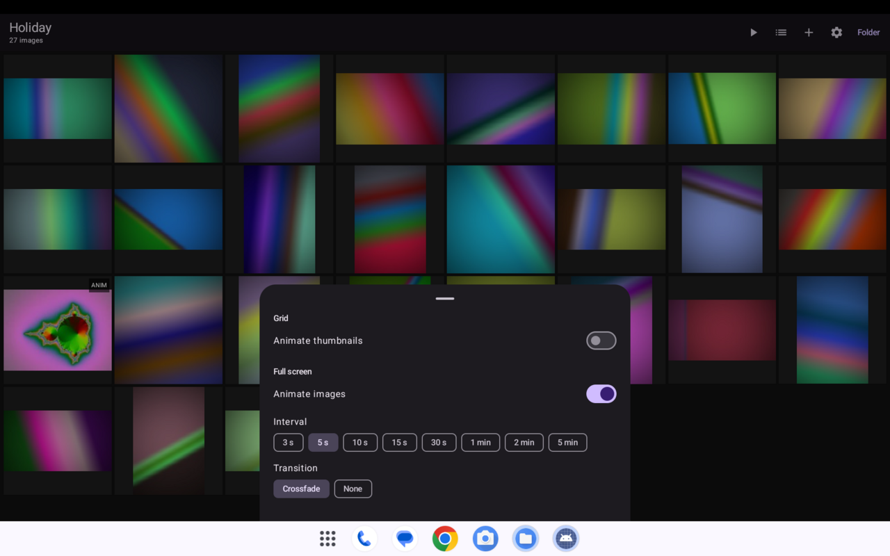
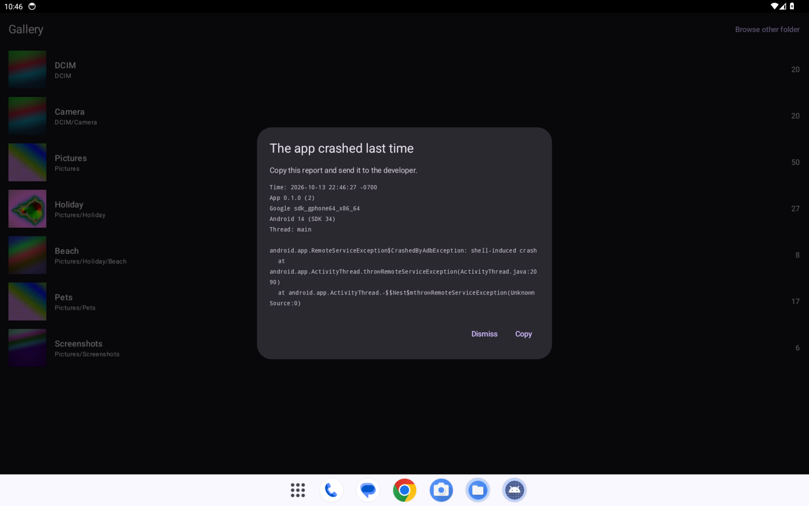

# Using Gallery

This guide walks through the app on the Fire Max 11 (landscape). For installing, see the [README](../README.md).

## Photo access

The first time you open Gallery it asks for access to your photos. Tap **Allow**; Android remembers it.

If you tap **Don't allow**, Gallery still works, but you have to pick a folder yourself each time:

Tap **Pick folder** and choose a folder in the system picker. Gallery shows every image in it, including its subfolders. If you tap **Don't allow** twice, Android stops asking. To change your mind later, go to **Settings > Apps & Notifications > Manage All Applications > Gallery > Permissions** and allow storage (photos and media) access.

## Folders

With access allowed, Gallery starts with a list of every folder that has images. Each row shows a cover picture, the folder name and path, and how many images are in it, counting its subfolders. A folder that only holds subfolders with images, such as Pictures, is listed too.

- Tap a folder to see it and all its subfolders.
- Gallery reopens the last folder you opened from this list the next time you start it.
- Tap **Folder** in the top bar of the grid to get back to the list.

### Browse other folder

If a folder is missing from the list (for example it has a `.nomedia` file, or it is on storage the tablet does not index), tap **Browse other folder** at the top right of the list and pick it in the system picker. Folders picked this way are not reopened on the next start, and picking one replaces the remembered folder, so the next start opens the folder list.

## Grid

The grid shows every image in the folder and its subfolders. The top bar has, from left to right, **Play**, **Sort**, **Size** (the **+** icon), **Settings** (the gear) and **Folder**.

### Sizes

Pinch to change the thumbnail size, or tap the **+** icon and choose **Small**, **Medium**, **Large** or **Extra large**.

### Sort

Tap the **Sort** icon to sort by **Name**, **Date modified**, **Folder path**, **File size** or **Random**. For all except Random, the last row of the menu switches between ascending and descending. With **Random**, tap **Reshuffle** for a new order.

### Animated images

Animated images (GIF, WebP and APNG) show an **ANIM** badge and a still picture in the grid. They animate full screen.

If you want the thumbnails to move, turn on **Animate thumbnails** in Settings (see below). GIFs larger than about 1 megapixel always stay a still with the **ANIM** badge in the grid, even with **Animate thumbnails** on, so a big GIF cannot slow the grid down. They still animate full screen.

## Full screen

Tap a thumbnail to open it full screen. It opens static, so you only swipe; nothing advances by itself until you tap **Play**.

- **Move between images:** swipe, or tap the left or right edge. It wraps around at the ends.
- **Zoom:** pinch or double-tap.
- **Controls:** tap the middle of the screen to show or hide them. At the top are the Back arrow, the file name and position, **Play**/**Pause**, the interval (tap it to change it) and Settings.

### Settings

Tap the gear, in the grid top bar or in the viewer controls, to open the Settings sheet.

- **Animate thumbnails** (grid): play animations in the grid. Off by default. GIFs over about 1 megapixel stay a still.
- **Animate images** (full screen): play animations when an image is open.
- **Interval:** how long each image stays up in a slideshow, from 3 s to 5 min.
- **Transition:** **Crossfade** or **None** between images in a slideshow.

Your sort order, grid size, these options and the last folder you opened from the list are saved between launches.

## Slideshow

Tap the **Play** icon in the grid top bar to start a slideshow from the first image, or tap **Play** in the viewer controls to start it from the image you are looking at. Gallery moves to the next image after the interval you chose. Tap **Pause** in the controls to stop.

## Duplicates

Each time you open a folder, Gallery looks for exact copies of its images in the background. While it works, the grid subtitle reads **finding duplicates** with a count. With photo access allowed it compares against every image on the tablet, so a copy in another folder counts; in a folder picked with **Browse other folder** it compares only the files in that folder.

Only byte-for-byte identical files count. The same picture saved again, resized or converted to another format is a different file and is not marked.

- Images with a copy get a yellow **DUP** badge in the grid.
- A **Duplicates (N)** button appears in the grid top bar. Tap it to show only the images with copies, with the copies of each one next to each other. Tap it again to show everything.
- Full screen, the controls show **Duplicate of** and the path of the other copy.

The first search in a large library reads the files that might match, which can take a while. Results are remembered, so later searches only read new or changed files.

## Deleting images

- **In the grid:** press and hold a thumbnail to start selecting, then tap more thumbnails to add or remove them. The top bar shows how many are selected, with **Select all**, **Select extra copies** (when there are duplicates) and the trash icon. **Select extra copies** picks every copy except the first of each group shown, so one copy of each always stays. Press Back or the X to stop selecting.
- **Full screen:** tap the middle to show the controls, then tap the trash icon to delete the image you are looking at. The viewer moves on to the next image.

What happens next depends on where the image came from:

- **Folders from the folder list:** Android asks you to confirm moving the images to the trash. Trashed images disappear from every gallery app and Android erases them after about 30 days. Until then the file is still on the tablet, renamed to start with `.trashed-`, in its folder; a file manager that shows hidden files can rename it back.
- **Folders picked with Browse other folder:** Gallery asks you to confirm, then deletes the files for good. This can't be undone.
- **Open with:** when you can swipe through the image's folder, deleting works as for the folder list. A single image on its own (Gallery could not list its folder) has no trash icon.

## Open with

Gallery can open images from other apps. In the Fire **Files** app or in ES File Explorer, press and hold an image, choose **Open with**, then **Gallery**.

With photo access allowed you can swipe through the other images in the same folder. If you denied access, or Gallery cannot work out or list the folder, a **Browse this folder** chip appears. Tap it and pick the folder once.

## Crash report

If Gallery crashes, the next launch shows the report in a dialog.

- Tap **Copy** to put it on the clipboard so you can send it to the developer.
- Tap **Dismiss** to delete it.
- Closing the dialog with Back, or by tapping outside it, keeps the report, so it shows again next launch. Only **Dismiss** deletes it.

After a crash Gallery opens at the folder list instead of the last folder, so a folder that crashed cannot crash it again. Tap the folder in the list to open it. If the system closes Gallery because the tablet is low on memory, no report is saved.
